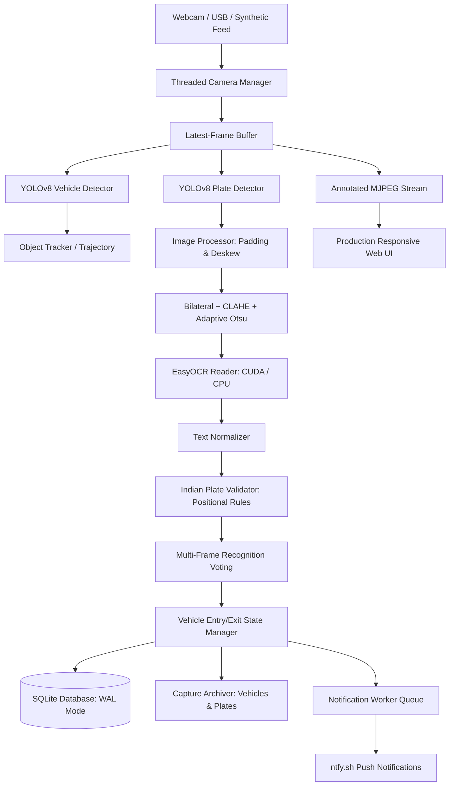

# Production-Ready Automatic Number Plate Recognition (ANPR) & Gate Access System

[](https://www.python.org/downloads/)
[](https://fastapi.tiangolo.com)
[](https://pytorch.org)
[](https://ultralytics.com)
[](https://github.com/JaidedAI/EasyOCR)
[]()
[]()

A modular, fault-tolerant Automatic Number Plate Recognition (ANPR) and Vehicle Entry/Exit Management System engineered for local execution on standard laptops and workstations.

---

## 🌟 Key Capabilities

1. **Dynamic Hardware Acceleration**: Automatically detects and leverages NVIDIA CUDA GPUs (e.g. GeForce RTX 3050 6GB Laptop GPU) with zero-cost fallback to CPU.
2. **Dual-Model Vision Pipeline**:
   - **Vehicle Detector**: YOLOv8 identifying cars, motorcycles, buses, and trucks.
   - **License Plate Detector**: Genuine dedicated YOLOv8 model trained specifically on license plates (`classes: ['license_plate']`).
3. **Indian Registration Recognition & Positional OCR Correction**:
   - Validates Standard State formats (e.g., `KA01AB1234`, `MH12A1234`, `DL3C1234`, `KA041234`).
   - Validates Bharat Series (e.g., `22BH1234AA`).
   - Context-aware positional character correction for common OCR ambiguities (`O/0`, `I/1`, `B/8`, `S/5`, `Z/2`) only at character positions where the format strictly demands letters or digits.
4. **State Machine & Anti-Duplicate Controls**:
   - `OUT <-> IN` automated state transitions with atomic SQLite transactions.
   - Configurable cooldown window (default 60s) preventing duplicate logs for stationary vehicles.
   - Continuous tracking session locking so idling vehicles cannot toggle states.
   - Configurable strategies: `toggle` and virtual `line_crossing` (top-to-bottom = IN, bottom-to-top = OUT).
5. **Role-Based Access Control (RBAC)**:
   - **ADMIN**: Complete system access, user management, configuration, database backup/restore, status overrides.
   - **OPERATOR (Guard)**: Real-time visual stream, quick manual gate entry/exit actions, vehicle search.
   - **AUDITOR**: Read-only compliance analytics, movement timeline, exportable logs.
6. **Production Responsive Web UI (Mobile & Desktop)**:
   - Modern Dark-Theme Single Page Application served directly by FastAPI at `http://localhost:8000/`.
   - **Mobile Experience**: Touch-friendly floating action buttons, compact bottom navigation bar, responsive fullscreen stream.
   - **Desktop Experience**: Multi-column live HUD telemetry, real-time activity feed, searchable registries, and high-resolution photo preview modals.
7. **Instant Mobile Push Notifications (ntfy.sh)**:
   - Zero-latency HTTP push notifications dispatched asynchronously via background queues.
   - Network failure resilience with exponential backoff retries. Never blocks computer vision frames.

---

## 📐 Architecture Pipeline



---

## 📂 Project Directory Structure

```text
NumberPlateDetector/
├── app/
│   ├── main.py                     # FastAPI server & static UI mount
│   ├── api/
│   │   ├── dependencies.py         # JWT Auth, RBAC guards, DB sessions
│   │   └── routes/
│   │       ├── auth.py             # Login, profile, user management
│   │       ├── vehicles.py         # Registry, history, manual gate actions
│   │       ├── events.py           # Historical movement logs
│   │       ├── cameras.py          # Camera status, reconnect, live MJPEG stream
│   │       └── system.py           # Health checks, telemetry, captures
│   ├── core/
│   │   ├── config.py               # Pydantic Settings & environment variables
│   │   ├── device.py               # Dynamic CUDA / MPS / CPU resolution
│   │   ├── logging_config.py       # Rotating log handler & query utilities
│   │   ├── security.py             # bcrypt hashing & PyJWT tokens
│   │   └── exceptions.py           # Structured error hierarchy
│   ├── database/
│   │   ├── connection.py           # SQLite WAL engine & RBAC seeder
│   │   ├── models.py               # SQLAlchemy ORM models
│   │   └── repository.py           # Clean data access layer & queries
│   ├── recognition/
│   │   ├── text_normalizer.py      # Alphanumeric cleaner
│   │   ├── plate_validator.py      # Indian regex & positional character corrector
│   │   └── recognition_verifier.py # Multi-frame sliding window voting
│   ├── services/
│   │   ├── camera_service.py       # Camera manager lifecycle
│   │   ├── capture_service.py      # Image archiving & retention purger
│   │   ├── event_service.py        # Central ANPR CV pipeline coordinator
│   │   ├── notification_service.py # ntfy.sh background worker
│   │   └── vehicle_state_manager.py# State machine with cooldown & transactions
│   ├── static/
│   │   └── index.html              # Production Web App (Mobile & Desktop)
│   └── vision/
│       ├── camera_manager.py       # Threaded capture & synthetic generator
│       ├── image_processor.py      # Crop padding, CLAHE, Otsu & deskew
│       ├── object_tracker.py       # IoU tracking & virtual line crossing
│       ├── plate_detector.py       # YOLOv8 license plate detector
│       ├── plate_ocr.py            # EasyOCR wrapper with GPU acceleration
│       └── vehicle_detector.py     # YOLOv8 vehicle detector & association
├── captures/
│   ├── vehicles/                   # Vehicle context captures
│   ├── plates/                     # Cropped plate snapshots
│   └── events/                     # Manual event captures
├── models/
│   ├── license_plate_detector.pt   # Dedicated plate YOLOv8 weights (MIT)
│   └── vehicle_detector.pt         # Pretrained vehicle YOLOv8n weights
├── scripts/
│   ├── download_models.py          # Weight download & integrity verifier
│   ├── initialize_database.py      # DB schema creator & table inspector
│   └── backup_database.py          # Online hot SQLite backup & restore
├── tests/
│   ├── test_auth.py                # RBAC & login tests
│   ├── test_api.py                 # REST endpoint tests
│   ├── test_database.py            # SQLite repository & transaction tests
│   ├── test_integration.py         # End-to-end synthetic pipeline test
│   ├── test_notifications.py      # ntfy.sh mock tests
│   ├── test_ocr.py                 # Multi-frame voting & device tests
│   ├── test_plate_validator.py     # Indian registration number tests
│   └── test_vehicle_state.py       # State transitions & cooldown tests
├── .env.example
├── requirements.txt
├── run.py                          # Master launcher
└── README.md
```

---

## ⚡ Quick Start

### 1. Environment Setup

Using your virtual environment:
```powershell
# Using the pre-configured Python 3.11 virtual environment
& "D:\PROJECTS\ProjectVision\.venv\Scripts\python.exe" -m pip install -r requirements.txt
```

### 2. Verify / Download Model Weights

Run the automated model download script:
```powershell
& "D:\PROJECTS\ProjectVision\.venv\Scripts\python.exe" scripts/download_models.py
```
*Downloads the verified, genuine YOLOv8 plate model (`best.pt` with class `{0: 'license_plate'}`) and the vehicle detection model.*

### 3. Initialize the SQLite Database

```powershell
& "D:\PROJECTS\ProjectVision\.venv\Scripts\python.exe" scripts/initialize_database.py
```
*Creates the database tables in WAL mode and automatically seeds the default RBAC accounts.*

### 4. Run the System

```powershell
# Run with default USB webcam (camera index 0)
& "D:\PROJECTS\ProjectVision\.venv\Scripts\python.exe" run.py

# Or run with synthetic test stream (no physical camera required):
& "D:\PROJECTS\ProjectVision\.venv\Scripts\python.exe" run.py --source synthetic
```

---

## 🔐 Role-Based Access Control (RBAC) Accounts

Default accounts pre-configured in the database:

| Role | Username | Password | Permissions |
| :--- | :--- | :--- | :--- |
| **ADMIN** | `admin` | `admin123` | Full access, RBAC user management, camera reconnect, DB backup, status override |
| **OPERATOR** | `guard` | `guard123` | Live feed, manual gate trigger, vehicle lookup, today's activity |
| **AUDITOR** | `auditor` | `auditor123` | Read-only analytics, movement logs, image inspection |

---

## 📱 Mobile Push Notifications (ntfy.sh)

To receive real-time push alerts on your smartphone whenever a vehicle enters or exits:

1. Install the free **ntfy** app from [Google Play Store](https://play.google.com/store/apps/details?id=io.heckel.ntfy) or Apple App Store.
2. Open the app and tap **+ (Subscribe to topic)**.
3. Enter your configured topic: `anpr_vehicle_events_demo`.
4. Tap **Subscribe**.
5. When a car approaches, your phone will receive an instant push notification:
   ```text
   Vehicle Entry Detected
   Registration: KA01AB1234
   Status: IN
   Time: 18-Nov-2026 10:30:45
   Confidence: 96%
   ```

---

## 🧪 Testing and Verification

Run the complete 31-test suite:
```powershell
& "D:\PROJECTS\ProjectVision\.venv\Scripts\python.exe" -m pytest tests/ -v
```

All 31 unit, integration, and security tests will execute:
- ✅ Positional OCR character substitution (`KAOIAB1234` -> `KA01AB1234`)
- ✅ Standard Indian and Bharat Series format validation
- ✅ Multi-frame confidence voting
- ✅ State machine transitions (`OUT` -> `IN` -> `OUT`)
- ✅ Cooldown anti-duplicate protection
- ✅ Stationary vehicle suppression
- ✅ Database WAL transaction consistency
- ✅ Hot database backup and restore
- ✅ Role-Based Access Control and JWT authentication
- ✅ REST API endpoints and production UI delivery

---

## ⚙️ Configuration Reference (`.env`)

| Variable | Default | Description |
| :--- | :--- | :--- |
| `DEVICE` | `auto` | Device selection: `auto` (detects CUDA), `cuda`, `cpu` |
| `CAMERA_SOURCE` | `0` | Camera index (`0`), video path (`test.mp4`), or `synthetic` |
| `DETECTION_CONFIDENCE` | `0.45` | YOLOv8 plate detection threshold |
| `OCR_CONFIDENCE` | `0.60` | Minimum EasyOCR confidence |
| `RECOGNITION_COOLDOWN`| `60` | Anti-duplicate cooldown in seconds |
| `EVENT_STRATEGY` | `toggle` | Gate logic: `toggle` or `line_crossing` |
| `DATABASE_URL` | `sqlite:///./vehicle_logs.db` | SQLite connection URL |
| `DATABASE_WAL_MODE` | `true` | Enables Write-Ahead Logging for concurrency |
| `NOTIFICATIONS_ENABLED`| `true` | Enables real-time ntfy.sh mobile alerts |
| `API_PORT` | `8000` | Port for Web UI and REST API |

# VehicleLogs

# VehicleLogs

# VehicleLogs

